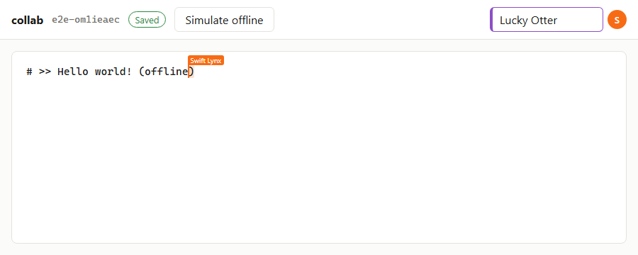

# CRDT Collaborative Editor

A real-time collaborative text editor built on a **custom sequence CRDT** in TypeScript, with
a Node.js WebSocket sync server, offline editing, and PostgreSQL persistence.

> Status: milestones 1–7 are done: the CRDT core, convergence testing, performance work, the
> sync server, Postgres persistence with snapshots, offline editing, and the web UI. Scale-out
> (Redis, k6 load tests, AWS deployment docs) is in progress.



## Goals

- **Custom CRDT:** an RGA sequence CRDT, implemented from scratch. Concurrent edits converge on
  every replica without a central lock.
- **Sync server:** a Node.js WebSocket server with rooms, presence/cursors and
  backpressure-aware broadcast.
- **Persistence:** an operation log in PostgreSQL plus periodic snapshots, for fast document loads.
- **Offline editing:** keep editing while disconnected, then merge on reconnect.
- **Verification:** property-based convergence tests, a deterministic network simulator, and k6
  load tests for concurrent editors and p99 sync latency.

## Repository layout

| Path                | What                                                                       |
| ------------------- | -------------------------------------------------------------------------- |
| `packages/crdt`     | The CRDT: zero dependencies, pure and deterministic                        |
| `packages/protocol` | Wire protocol messages and validation                                      |
| `apps/server`       | WebSocket sync server (Postgres op log + snapshots, Redis fan-out)         |
| `bench/`            | Benchmark scripts and recorded results                                     |
| `docs/`             | [DESIGN.md](docs/DESIGN.md) |

## Design decisions

The full reasoning is in [docs/DESIGN.md](docs/DESIGN.md). In short:

- **CRDT over OT,** because offline editing must merge without a server re-sequencing history.
- **RGA over YATA:** one origin per insert, and a ten-line integration rule with a short
  correctness argument. Forward typing never interleaves. Text typed backwards can interleave;
  this is a documented limitation, with a test pinning the exact output.
- **IDs are `(Lamport clock, replica)`.** Delivery is tracked separately by a contiguous
  per-replica `seq`, so version vectors are exact.
- **Run-length-encoded runs in a block list, with a per-replica ID index.** The runs double as
  the op log.
- **Tombstones are kept forever.** Garbage collection needs causal stability, which offline
  replicas make undecidable. See DESIGN §4 for the trade-off.

## Benchmarks

Everything below was measured on one machine. Nothing is estimated.

- **CPU:** Intel Core i3-1115G4 (2 cores / 4 threads, 3.0 GHz), a laptop part
- **RAM:** 7.8 GiB
- **OS / runtime:** Windows 11, Node.js 26.8.1

Raw results are in `bench/results/`. Laptop timings vary from run to run (turbo and thermal), so
ranges are given across 4 clean runs of the optimized build. The naive build was measured once:
each workload takes 12–75 s.

### Convergence testing (milestone 2)

| What                                                                     | Cases per CI run |
| ------------------------------------------------------------------------ | ---------------- |
| Random concurrent histories, adversarial delivery, all replicas converge | 10,000           |
| `opsSince` catch-up from arbitrary partial states                        | 10,000           |
| Optimized `Doc` ≡ naive reference (differential)                         | 5,000            |
| Snapshot round-trip, then continue editing                               | 3,000            |
| Network simulator: partitions, 0–40% drops, duplicates, reordering       | 500              |

- **Case size:** a convergence case averages 71 ops (max 178) across 2–4 replicas, and 99.6% of
  cases involve more than one replica.
- **Mutation check:** `scripts/mutation-check.sh` injects 5 known CRDT bugs, and the suite
  catches all 5.
- **Runtime:** the whole CRDT suite at CI size takes about 46 s on this machine.

### CRDT throughput and memory (milestone 3)

`node --expose-gc bench/crdt.bench.ts --impl=optimized|naive`

The traces are real recorded editing sessions from
[josephg/editing-traces](https://github.com/josephg/editing-traces) (ASCII variants), fetched by
`bench/fetch-traces.sh`:

- **`automerge-paper`:** Martin Kleppmann typing a paper. 259,778 ops; 104,852 chars at the end.
- **`seph-blog1`:** Joseph Gentle writing a blog post. 368,209 ops; 56,769 chars at the end.
  CC BY 4.0.

Each replay checks the final text against the trace's recorded result.

| Workload                                      | Naive (before) | Optimized (after), 4 runs | Speed-up  |
| --------------------------------------------- | -------------- | ------------------------- | --------- |
| Append 100K chars, one at a time              | 14.2 s         | 22–41 ms                  | ~350–650× |
| 100K single-char inserts at random positions  | 12.2 s         | 0.28–0.95 s               | ~13–44×   |
| `automerge-paper` local replay (260K ops)     | 60.9 s         | 0.62–1.05 s               | ~60–100×  |
| `automerge-paper` remote integrate (260K ops) | 13.3 s         | 0.77–1.61 s               | ~8–17×    |
| `seph-blog1` local replay (368K ops)          | 75.0 s         | 0.61–0.97 s               | ~77–120×  |
| `seph-blog1` remote integrate (368K ops)      | 16.5 s         | 0.87–1.29 s               | ~13–19×   |

Memory is the heap retained by the document after a full GC. It was identical across runs.

| Memory                                | Naive    | Optimized | Reduction |
| ------------------------------------- | -------- | --------- | --------- |
| `automerge-paper`: whole document     | 46.8 MiB | 4.53 MiB  | 10.3×     |
| …per inserted char (incl. tombstones) | 269 B    | 26 B      |           |
| …per visible char                     | 468 B    | 45 B      |           |
| `seph-blog1`: per inserted char       | 289 B    | 36 B      | 7.9×      |

### Document load time with vs. without snapshots (milestone 5)

`DATABASE_URL=... node bench/load.bench.ts`. This measures loading `automerge-paper` (260K ops)
from Postgres 17 (Docker, same machine) and materializing the `Doc`. Each run takes the median of
5 loads, and the table gives the range across 2 runs. Every load checks the final text.

| Load path                                                  | Time        | Speed-up |
| ---------------------------------------------------------- | ----------- | -------- |
| Full op-log replay (no snapshot)                           | 2.46–2.82 s | 1×       |
| Latest snapshot + 0-op tail                                | 39–41 ms    | ~60–70×  |
| Latest snapshot + 1000-op tail (worst case at the cadence) | 65–82 ms    | ~34–38×  |

- **Snapshot size:** 0.79 MB of JSON, containing the full history.
- **Incremental compaction:** 151 ms per 1,000 ops.
- **Appending the trace** in 500-op batches ran at 11–17K ops/s.

### Not measured yet

- p50/p99 op propagation latency and concurrent editors per document (k6, milestone 8)

## Development

```sh
pnpm install
pnpm test            # all packages (set FC_NUM_RUNS=10000 for the CI-sized property runs)
pnpm lint && pnpm typecheck
bench/fetch-traces.sh && node --expose-gc bench/crdt.bench.ts
```

## Limitations

- Text typed backwards, concurrently at the same position, can interleave (RGA; see DESIGN §3).
- Tombstones are never garbage-collected (DESIGN §4).
- Elements are UTF-16 code units. The editor never splits a surrogate pair, but concurrent edits
  are not prevented from landing between the two halves of one.
